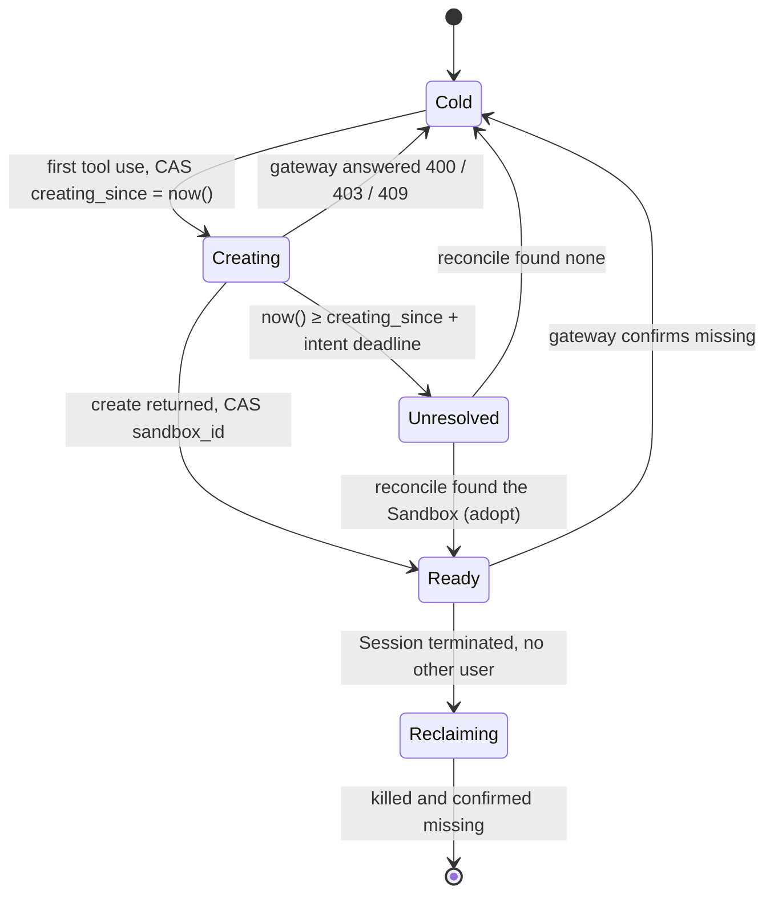

# ADR-0023: A Sandbox binding is reconciled against the gateway, never left unconfirmed

## Status

Accepted 2026-10-24: approved by the maintainer for #280 (parent #278). The
design was settled with the maintainer in a review on 2026-10-23/24 and is
implemented by #281–#291, accepted on oma-test by #292.

Supersedes [ADR-0019](0019-native-sandbox-lifecycle.md)'s ambiguous-creation
paragraph (operator-only reconciliation, automatic replacement disabled) and
its statements that there is no adoption phase, no OMA resource sweeper and no
recurring Sandbox scan. Revises ADR-0019's runtime budgets. See "Superseded and
revised decisions".

Revised by [ADR-0024](0024-environments.md): the Session field and the Redis
signal kind `environment` below are renamed `sandbox`, with no alias, and an
"environment failure" is now called a Sandbox unavailability.

Revised by [ADR-0025](0025-sandbox-1c4g-delete-on-idle.md) (2026-10-30):
Sandboxes are deleted at their deadline, never paused, so OMA lists running
Sandboxes only; reconciliation keeps the earliest claimed one (not "a running
one, else the earliest claimed"), the sweeper has no `paused` keep class, and
an unused Ready Sandbox is shortened to 15 minutes and then deleted.

## Context

A binding (`delegation_environments`, one per root Session, shared by its Child
Sessions) records which Sandbox the Session uses. Before calling the gateway's
create, `ensurePrepared` commits `creation_pending = true`; only a successful
create followed by a successful binding write clears it
([`sandbox-manager.ts`](../../server/packages/sandbox/src/sandbox-manager.ts)). Every other outcome leaves
it set forever:

- any create rejection, including a definite gateway error, is reported as
  "creation response is unconfirmed";
- the Runner exits or crashes between create and the binding write. A graceful
  shutdown waits 20 s, detaches the Turn and exits; create may take 150 s;
- the binding write itself fails (PG connect timeout, concurrent change,
  Session terminated).

Every later Turn of the Session, and of its Children, then polls the row every
100 ms for 185 s and ends with `sandbox_prepare_failed`. Nothing clears the
marker except an operator. Termination cannot reclaim the Sandbox either:
`claimReclamation` returns no ticket while `sandbox_id` is null.

Evidence:

- **oma-test, 2026-10-21.** A burst of 200 Sessions left 195 bindings pending.
  Of 390 "unconfirmed" tool results, 384 arrived at about 150 s (the gateway's
  claim timeout answering an error, after which the gateway deletes the failed
  claim) and 6 at 185 s (the client timeout, reached while the request waited
  for one of the SDK's 100 connections per process).
- **Production, 2026-10-22.** A console redeploy of the Runners at 21:22:35
  (+08) during the prod300 batch cut 10 Sessions between create and the
  binding write. All 10 Sandboxes had been claimed and were Ready at
  21:20:10–21:21:02, and carried `oma.dev/binding`. The resumed Turns waited
  185 s and ended with `sandbox_prepare_failed` at 21:28; the Sandboxes ran
  24 h unused, then paused.
- **Read-only orphan report, 2026-10-24 03:10Z.** The gateway held 707 claimed
  OMA Sandboxes. 696 were recorded by production bindings. 11 were recorded by
  none: the 10 above, and one oma-test Sandbox that the production list also
  returns, because both environments use the same gateway API key. One
  recorded Sandbox, created before ADR-0019's cutover, had no deadline at all
  and had been Running since 2026-10-08; the gateway's `setTimeout` silently
  skips Sandboxes without a deadline (upstream `pkg/servers/e2b/timeout.go`),
  so ADR-0019's idle shortening never applied to it. It was killed by hand on
  2026-10-24 after checking that it had no user.

Facts about the gateway (ACK sandbox-manager v0.6.11, upstream openkruise/agents
v0.6.0):

- The Runner calls `sandbox-manager.sandbox-system.svc:8080` directly
  (`E2B_API_URL`). No ALB or proxy is on this path; the "slightly exceeds ALB
  180 s" rationale of the 185 s client timeout does not apply.
- The claim timeout bounds the whole claim, including the wait for a free claim
  worker and the wait for readiness; wait-ready runs inside it, the two do not
  add up.
- A claim does not accept a client-chosen name (only clone does), so create
  cannot be made idempotent.
- `GET /v2/sandboxes?metadata=oma.dev/binding=<id>&state=running,paused`
  filters exactly: verified on 2026-10-23 against a stuck binding (1 result),
  a nonexistent one (0) and no filter (100, the page size). Pagination with
  `x-next-token` works; the full list of 707 took 8 pages and 141 ms from
  inside the cluster, about 1 KB per Sandbox, served from the manager's cache.

Mature platforms address a Sandbox by a stable name and treat it as cattle:
OpenHands looks a runtime up by session id and attaches, resumes or starts it;
Cloudflare maps a name to one Durable Object and container; ADK stores the
Sandbox name in session state. Where create cannot be idempotent, the general
practice is to look the resource up by its label and adopt or remove what is
found, as Kubernetes controllers do. None of them turns an unknown outcome into
a permanent state.

## Decision

### The gateway is the truth; the binding records intent

A binding is identified by `oma.dev/binding` (the root Session's id) on the
Sandbox. Whether a Sandbox exists is answered by the gateway; the binding row
records what OMA intends and how far it got. When the two disagree, OMA asks
the gateway by binding and converges. It never blocks on an unknown outcome.

`creation_pending boolean` becomes `creating_since timestamptz`, written with
the database clock. The states are derived, not stored:



Every Sandbox OMA creates also carries `oma.dev/environment`
(`production` or `test`).

### Budgets come from one constant

```ts
const CLAIM_SECONDS = 150;                              // the gateway's real bound
const WAIT_READY_SECONDS = CLAIM_SECONDS - 15;          // leaves time for init and mount
const CREATE_REQUEST_MS = (CLAIM_SECONDS + 20) * 1000;  // client timeout of create
const INTENT_DEADLINE_SECONDS = CLAIM_SECONDS + 30;     // after it, nothing can still be created
```

The client timeout exceeds the gateway's bound, so the creator normally learns
the outcome itself; the deadline exceeds the client timeout, and a client abort
cancels the gateway's claim, so once the deadline passes no create of that
attempt is still in flight. `E2B_REQUEST_TIMEOUT_MS` and its 180–300 s
validation are removed; other control-plane calls keep their own shorter fixed
timeouts. The SDK's HTTP client has a 300 s header timeout, which caps the
create request.

### ensure

```text
ensure(binding)                     # on the first tool use of a Turn; later tools reuse the handle
  row = read binding
  Ready      → connect(sandbox_id); confirmed missing → CAS Cold, retry
  Creating   → wait for the binding's signal or the deadline
  Unresolved → reconcile(), retry
  Cold       → create()

create()
  CAS Cold → Creating(now())
  handle = gateway.create(metadata: oma.dev/binding, oma.dev/environment)
    400 / 403 / 409   → CAS Creating → Cold; tool error
    5xx / timeout / connection lost
                      → wait for the deadline, reconcile(), and if it found
                        none, create once more in the same tool call; then a
                        tool error
  CAS Creating → Ready(handle.id); publish the binding's signal
    CAS failed (the row moved on) → kill handle.id
  verify the Workspace mount; install Skills (ADR-0022)
```

`reconcile` runs only after the deadline:

```text
reconcile(binding)
  found = gateway.list(metadata oma.dev/binding = id, state = running,paused)
  0 → CAS → Cold
  1 → CAS → Ready(found)
  n → CAS → Ready(a running one, else the earliest claimed); kill the others
```

Waiters for a binding in Creating are other Turns: a Child Session sharing it,
or a Turn resumed after a takeover. The creator publishes a control-scope
`RedisSessionSignals` signal of a new kind `environment` whose `sessionId` is
the binding id; waiters re-read the row when it arrives and every 2 s
regardless, and act on the row alone. Parallel tool calls in one process share
one in-memory promise as today.

### The Router acquires and releases; failures are tool errors

The Sandbox protocol (resource use, activity, binding, preparation, release)
moves out of the Router into the sandbox package. The Router keeps only:

```ts
interface TurnSandboxes {
  /** null for an Agent that is not sandboxed. */
  acquire(req: { session: Session; agent: Agent; fence: PendingEventFence; signal: AbortSignal }): Promise<SandboxLease | null>;
}
interface SandboxLease {
  readonly executor: ToolExecutor;            // fenced
  checkWorkspace(): Promise<void>;
  release(evidence: { settled: boolean }): Promise<void>;
}
```

- A `SandboxSession` lives for one Turn. The per-process cache of handles, kept
  until Session termination, and its sticky `creationUnconfirmed` flag are
  removed; the binding row is the only state.
- For a Ready binding, `acquire` starts connect and mount verification in the
  background; the first tool waits for it. A Cold binding stays cold until a
  tool needs it. The model's first request never waits for a container.
- An environment failure is a tool error carrying `details.code`
  (`sandbox_unavailable`, `sandbox_creating`), not the end of the Turn. The
  Turn records `span.sandbox_prepare_start` and `span.sandbox_prepare_end`
  (`outcome`, `code`, `sandboxId`, duration).
- If the environment failed during the Turn and never became ready again, the
  Turn records `session.error {code: "sandbox_unavailable"}` before completing,
  as the Workspace check already records `workspace_storage_error`. A Turn
  that recovered records no error. A `session.error` is never written in the
  middle of a Turn: `planResume` treats one as the end of the Turn.
- `GET /sessions/{id}` reports `environment: {state, since, last_error}` with
  `state` one of `cold`, `creating`, `ready`, `unavailable`, read from the
  binding.

### Release and reclamation

Turn end is unchanged from ADR-0019: the last settled user shortens the
deadline to 30 minutes. Explicit termination kills the recorded Sandbox and
every Sandbox the gateway lists for the binding, confirms they are missing,
then clears the row.

### The sweeper

Every Runner runs a sweeper every 10 minutes with random jitter. There is no
lock between Runners: each action is decided again under the binding's row
lock just before it is taken, and kill is idempotent. One round lists the
environment's Sandboxes from the gateway and reads their bindings with one
query.

| Sandbox S labelled with binding B | Action |
|---|---|
| B's row is Ready(S) and B has a user or queued input | none |
| B's row is Ready(S), no user, no queued input, deadline later than 30 min | `setTimeout(30 min)`; a Sandbox with no deadline at all is killed, because `setTimeout` is a no-op for it |
| B's row is Ready(S2), S2 ≠ S | kill S |
| B's row is Cold | kill S (nothing would ever adopt it) |
| B's row is Creating before its deadline | none (the creator may be producing S) |
| B's row is Creating after its deadline | reconcile: adopt S; with no user, shorten to 30 min |
| B has no row in this environment, or all its Sessions are terminated | kill S |

- It only acts on Sandboxes labelled with its own `oma.dev/environment`. A
  Sandbox without the label (created before this ADR) is acted on only when its
  binding exists in this environment's schema; otherwise it is left to its
  platform deadline.
- It kills at most 50 Sandboxes per round.
- Each round writes one structured log line: `{"msg":"sandbox_sweep", env,
  orphans, unresolved, unusedRunning, noDeadline, killed, adopted, ms}`.
  Alerting is configured on the log service, not in the application.
- Selection is a pure function. Before the sweeper is enabled, a one-off script
  runs it in report-only form against each environment; there is no permanent
  dry-run switch.

### Environment isolation

Production and test currently share one gateway API key, so each sees the
other's Sandboxes. The `oma.dev/environment` label scopes the sweeper; in
addition the test environment gets its own API key. The gateway lists only
Sandboxes owned by the calling key, so the separation then also holds at the
gateway. Test Sandboxes created under the shared key keep their owner, carry no
environment label, have no binding in the production schema, and expire on
their platform deadline.

### Migration and rollout

```sql
ALTER TABLE delegation_environments ADD COLUMN creating_since timestamptz;
UPDATE delegation_environments SET creating_since = 'epoch' WHERE creation_pending;
ALTER TABLE delegation_environments DROP COLUMN creation_pending;
```

The Runners are scaled to 0 for the migration, so no create is in flight and
no old code writes the old column; rows that were pending are therefore past
their deadline, and the first use or sweep reconciles them. Then the new image
starts. There is no compatibility branch. Rollback restores the column with
`DEFAULT false`, sets it to true where `creating_since` is not null, and
returns to the previous image.

Order: the report-only sweep for both environments, the test API key, oma-test,
then production.

## Verification

- Crash injection covers every edge of the state diagram: a Runner killed after
  committing the intent and before create, during create, after create and
  before the binding write, during the write, and during Skill install; a late
  creator whose write fails; a gateway 500 and a create timeout; a list that
  does not yet show a fresh claim.
- On oma-test, a burst of 200 Sessions with a rolling Runner restart during
  creation must leave no binding in Creating past its deadline, no orphan after
  one sweeper period, and no Turn ending with `sandbox_unavailable` while the
  gateway is available.

## Consequences

- A Session can no longer be stuck without a Sandbox. After a Runner is lost
  during creation, its Turn can use a Sandbox again at most 180 s after the
  intent was written.
- A create with an unknown outcome can cost one tool call about 6 minutes in
  the worst case (create, wait for the deadline, reconcile, create once more).
- A second Sandbox can exist for a while when a creator was not dead, only
  stalled, past the deadline, or when the gateway completed late. The late
  creator kills its Sandbox when its write fails; if it died first, the sweeper
  kills it within one period. Both Sandboxes mount the same Workspace prefix and
  only the recorded one receives commands, so no data diverges.
- An unused Ready Sandbox is paused 30 minutes after the sweeper finds it, even
  when its last Turn ended with an uncertain execution whose process may still
  run. This is the same pause an ordinary idle Sandbox gets; nothing is killed
  unless the Sandbox has no deadline at all.
- Each Runner adds about one list per page of 100 Sandboxes and one PG query
  every 10 minutes.

## Not decided here

- A per-Runner create queue: deferred by the maintainer. Without it, more than
  100 concurrent creates in one Runner wait for an SDK connection and may reach
  the client timeout; reconciliation then handles them as unknown outcomes.
- A fleet-wide create gate and sizing the warm pool for batches: a later step.
- Hung tool commands and the three-hour Host wait (ADR-0019, "Host tool wait
  ceiling"): a separate track.
- Plaintext credentials in Sandbox annotations and sandbox-manager logs: #260
  and #277.

## Rejected alternatives

- **Keep operator reconciliation.** It is the cause: 205 stuck bindings in two
  days, each discovered by a user.
- **Make create idempotent by name.** The gateway's claim does not accept a
  client-chosen name.
- **One sweeper per environment behind a PG advisory lock.** The session lock
  holds a pooled connection across gateway calls, the pattern behind the
  Runner pool deadlock, and correctness does not need exclusivity.
- **Longer budgets (claim 240 s).** Fewer creates would fail in bursts only if
  the gateway can finish them in the extra time, which the 2026-10-21 burst
  does not show; failure and recovery would take longer, slow creates would
  hold SDK connections longer, and the client timeout must stay under 300 s.
- **Rely on platform expiry instead of a sweeper.** Unused Sandboxes of
  unresolved bindings run 24 h, and a Sandbox without a deadline runs until its
  Session is terminated.

## Superseded and revised decisions

- ADR-0019, "Faults and persistence": "An ambiguous create or binding commit
  blocks automatic replacement … operators must inspect the exact binding
  metadata before attaching a confirmed resource or clearing an intent" is
  replaced by reconciliation against the gateway.
- ADR-0019, "Decision": "there is no second resource-use ledger, … adoption
  phase, custom resource probe or fallback policy" and "There is no OMA idle
  clock or reclamation scanner" are revised: OMA adopts by binding and runs a
  sweeper. There is still no idle clock in OMA; deadlines stay on the platform.
- ADR-0019 and [`docs/sandbox-lifecycle-deployment.md`](../sandbox-lifecycle-deployment.md), runtime budgets: the
  185 s client budget "slightly longer than ALB's 180 seconds" is replaced by
  the budgets above.
- `docs/sandbox-lifecycle-deployment.md`, "Recovery": manual reconciliation and
  "no recurring Sandbox scan" are replaced by this ADR.
